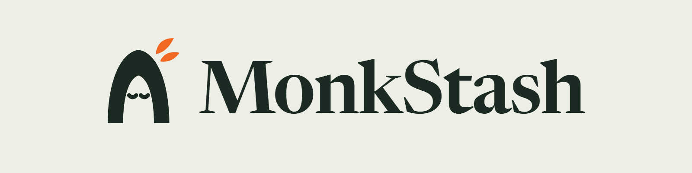
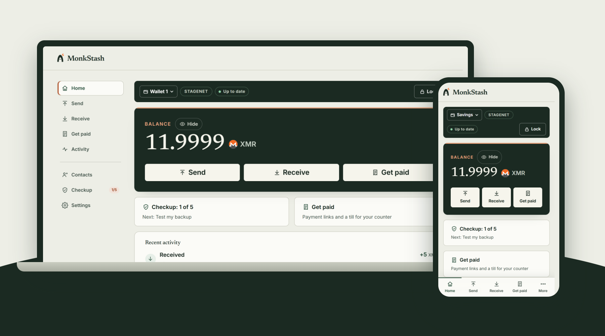
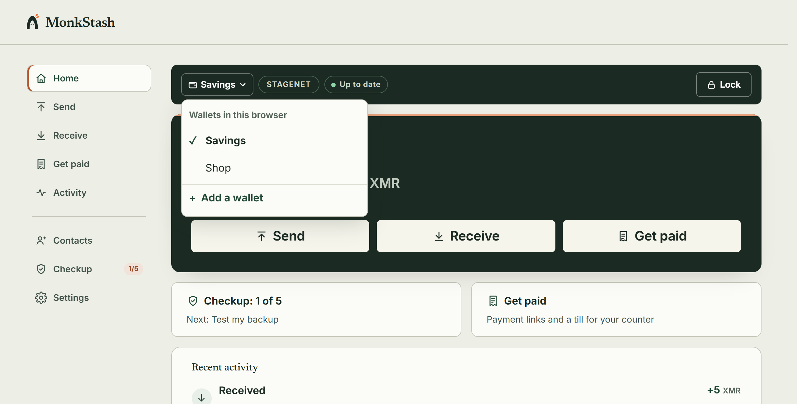
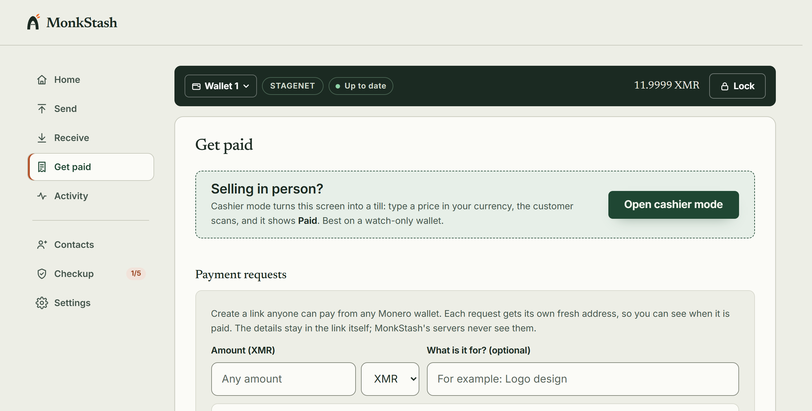

<p align="center">
  <picture>
    <source media="(prefers-color-scheme: dark)" srcset="docs/assets/monkstash-logo-dark.png">
    
  </picture>
</p>

<p align="center">
  <strong>A free Monero (XMR) wallet that lives in your browser.</strong><br>
  Your keys are made on your device, stay on your device, and never touch our server.
</p>

<p align="center">
  <a href="https://wallet.monkstash.com"><strong>Open the wallet</strong></a>&nbsp;&nbsp;|&nbsp;&nbsp;
  <a href="https://monkstash.com/monero-chrome-extension">Browser extension</a>&nbsp;&nbsp;|&nbsp;&nbsp;
  <a href="https://monkstash.com">Website</a>&nbsp;&nbsp;|&nbsp;&nbsp;
  <a href="https://monkstash.com/verify">Verify the build</a>&nbsp;&nbsp;|&nbsp;&nbsp;
  <a href="https://github.com/90ssolo/monkstash/discussions/categories/help-support">Get help</a>
</p>

<p align="center">
  <a href="LICENSE"></a>
  <a href="https://github.com/90ssolo/monkstash/actions/workflows/reproducible-builds.yml"></a>
  <a href="https://github.com/90ssolo/monkstash/releases"></a>
  
</p>

<p align="center">
  <br>
  <sub>Screenshots use the wallet's built-in demo data on the Monero test network.</sub>
</p>

---

## ✨ Why MonkStash

- 🔐 **Your keys, your device.** Recovery words and keys are created in your browser, encrypted with your password and stored only there. No server ever receives them.
- 🙅 **No account.** No email, no sign-up, no KYC. Open the page and make a wallet in about two minutes.
- 🧩 **Nothing to install.** It runs in any modern browser. Prefer an extension? Chrome and Firefox builds are here too.
- 🔍 **Check us, don't trust us.** Every line is open source, and builds are reproducible: anyone can rebuild the wallet and confirm the live site serves exactly this code.
- 💸 **Free.** No fees on top of the normal Monero network fee.

## 🧰 What you can do

| | |
|---|---|
| 🆕 **Create or restore** | New wallet, or restore from 25 words, a 13-word MyMonero phrase or a 12-word Exodus phrase, all converted in your browser |
| 👀 **Watch-only wallets** | Follow a wallet with its view key: sees payments, can never spend |
| 🗂️ **Several wallets** | Keep savings, a shop and more in one browser. Switch from the menu at the top; one password unlocks them all |
| 📤 **Send** | Every payment asks for your password. Send to OpenAlias names like `donate.getmonero.org`, with the DNSSEC status shown |
| 📥 **Receive** | A fresh subaddress for every request, with a QR code |
| 🧾 **Get paid** | Payment links priced in EUR, USD and more, with expiry, a return link and a ready-made "Pay with Monero" button. Marked paid automatically |
| 🏪 **Cashier mode** | A point of sale for your counter: keypad, QR per sale, sales list encrypted on the device, CSV export |
| 🛡️ **Security checkup** | Five quick checks: test your paper backup, add a second lock, bookmark the wallet and more |
| 🔑 **Optional 2FA** | An authenticator code on top of your password, checked on your device |
| 🔒 **Auto-lock** | Locks after 10 minutes idle, or soon after you leave the tab (your choice) |
| 🖥️ **Your own node** | Connect straight to your own Monero node in Settings. The address stays inside your encrypted wallet |
| 🧳 **Move files** | Take a wallet to another browser without waiting for a full rescan |

<p align="center">
  
  
</p>

## 🧩 Browser extension

The same wallet as an extension for **Chrome** and **Firefox**, built from this repository. The store listings are still in review, so for now you can install a release by hand. Get it only from [monkstash.com/monero-chrome-extension](https://monkstash.com/monero-chrome-extension), which links the official files and their checksums.

Each [release](https://github.com/90ssolo/monkstash/releases) lists build fingerprints that are identical on Intel and ARM Linux and on Windows. The extension also shows its fingerprint in Settings.

## 🏪 For shops and businesses

- **MonkStash Pay** (`apps/pay`): a self-hosted payment gateway. It only ever holds a view key, so it can see payments arrive but can never spend them. Invoice API, checkout page and signed webhooks.
- **WooCommerce plugin** (`integrations/woocommerce`): take Monero in your shop through your own MonkStash Pay server.
- **MonkStash Server** (`server/`): one command installs a pruned Monero node on Debian or Ubuntu, from the official release with its signature checked, with HTTPS, a firewall and a status page. Add `--pay` for MonkStash Pay. See [monkstash.com/server](https://monkstash.com/server).

MonkStash Pay and the plugin are in testing on stagenet; there is no packaged release yet.

## 🛡️ How it protects you

- **Keys stay on the device.** The wallet engine is [monero-ts](https://github.com/woodser/monero-ts), the official Monero code compiled to WebAssembly. Secrets are encrypted with PBKDF2-SHA256 and AES-256-GCM through the Web Crypto API.
- **No custom cryptography.** Restores from other wallets use audited libraries (`@noble/hashes`, `@scure/bip39`, `@scure/bip32`) and are tested against published vectors.
- **A strict Content Security Policy** on wallet and payment pages: only scripts with a fresh per-request nonce, no third-party code, no framing.
- **The wallet has its own origin** (`wallet.` subdomain), so content pages can never read its storage.
- **No analytics on wallet pages.** No cookies, no trackers.
- **What the server can see.** The default node relay sees a wallet's IP address and sync requests, never its keys. Connect to your own node in Settings to skip it. Payment link details live in the URL fragment, which browsers never send to a server.

> [!IMPORTANT]
> MonkStash is an early preview and has not had an independent security audit yet. Use small amounts until it has. Never share your recovery words: nobody from MonkStash will ever ask for them.

## 🔍 Verify the build

Builds are reproducible: the same commit, built in Docker with the pinned base image, gives byte-identical files. Each release publishes `/build.json` (the commit, the public build settings and a SHA-256 for every file a browser can download), and the wallet shows the fingerprint in Settings.

```bash
node scripts/verify-build.mjs https://wallet.monkstash.com
```

That checks every live file against the manifest. To compare with your own build of the same commit, follow [monkstash.com/verify](https://monkstash.com/verify), which fills in the exact commit and settings and explains what this proves and what it does not.

## 📁 What is in this repository

| Path | What it is |
|---|---|
| `packages/wallet-core` | Shared, unit-tested logic: vault encryption, address and amount checks, payment links, invoices, restore formats (MyMonero, Exodus), height estimates |
| `packages/node-client` | The client the wallet uses to talk to Monero nodes through the relay |
| `apps/web` | The website and the wallet (Next.js), with the node relay, the free tools and the `/pay` page for payment links |
| `apps/extension` | The Chrome and Firefox extension, built from the same wallet code |
| `apps/pay` | MonkStash Pay, the self-hosted payment server for shops |
| `integrations/woocommerce` | WooCommerce plugin for MonkStash Pay |
| `server` | The MonkStash Server installer (signed) |
| `deploy` | Docker Compose, Caddy and Tor files to run the whole site on one server |

## 💻 Run it locally

Requirements: Node.js 24 and pnpm 10.

```bash
pnpm install
cp apps/web/.env.example apps/web/.env.local
pnpm dev     # http://localhost:3210 (stagenet by default)
pnpm test    # unit tests
```

Set `NEXT_PUBLIC_MONERO_NETWORK` to `stagenet`, `testnet` or `mainnet`, and `MONERO_NODE_URLS` to the nodes the relay should use, for example your own node at `http://127.0.0.1:18081`.

To run the whole site on your own server, see [deploy/README.md](deploy/README.md): one small Debian or Ubuntu server, Docker, automatic HTTPS and an optional onion mirror.

## 💬 Help and feedback

- Questions: [Help & Support discussions](https://github.com/90ssolo/monkstash/discussions/categories/help-support)
- Ideas: [Ideas & Features](https://github.com/90ssolo/monkstash/discussions)
- Security issues: security@monkstash.com (see [SECURITY.md](SECURITY.md))
- Official accounts: this repository and [@monkstash on X](https://x.com/monkstash). Anyone else using the name is not us.

## 🧡 Support the project

MonkStash is free and takes no fee on payments. Donations in XMR pay for its development:

```
49e3LYdPPHjgf27mSUD6ya8P5zcgwa8CWaBRjgEq44EtHqppMhLTSVsRuWpW4zCNeFWrGPvnxakAccZjtQBMQtLeJAYou4F
```

The donation wallet is public: its private view key and a live total are on [monkstash.com/donate](https://monkstash.com/donate), so anyone can check every donation. Always compare the address with that page before sending.

## 📄 License

BSD-3-Clause. See [LICENSE](LICENSE).
